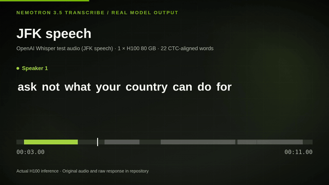
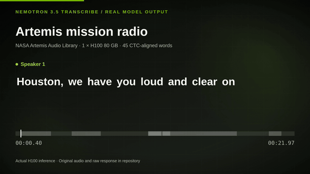

# Nemotron 3.5 Transcribe on one H100

Three short demos using **real NVIDIA Nemotron 3.5 Transcribe inference** on one H100 80 GB. Watch word-synced captions on a conversation, a speech, and mission radio; then run the same model and audio yourself.

[**User Guide: run the model on vLLM**](#user-guide)

## Demo videos

### Two-speaker conversation · 34 seconds

[](https://darren236.github.io/nemotron-transcribe-h100-demos/conversation.html)

An original two-voice dialogue shows speaker-tagged turns and word-by-word captions. [Play the full video](https://darren236.github.io/nemotron-transcribe-h100-demos/conversation.html) · [Run this example](#two-speaker-conversation)

### JFK speech · 11 seconds

[](https://darren236.github.io/nemotron-transcribe-h100-demos/jfk.html)

A human-speech clip shows word timestamps and subtitles on the [JFK recording used by Whisper](https://github.com/openai/whisper/blob/main/tests/jfk.flac). [Play the full video](https://darren236.github.io/nemotron-transcribe-h100-demos/jfk.html) · [Run this example](#jfk-speech)

### Artemis mission radio · 22 seconds

[](https://darren236.github.io/nemotron-transcribe-h100-demos/artemis.html)

The model transcribes a clip from the [NASA Artemis Audio Library](https://www.nasa.gov/artemisaudio/). The captions show its unedited output, including words that should be checked by listening. [Play the full video](https://darren236.github.io/nemotron-transcribe-h100-demos/artemis.html) · [Run this example](#artemis-mission-radio)

## User Guide

This guide follows [NVIDIA's Nemotron 3.5 Transcribe model card](https://huggingface.co/nvidia/NVIDIA-Nemotron-3.5-Transcribe-30B-A4B) and the versions used for the videos. It serves downloaded BF16 weights with open-source NeMo Speech and vLLM; these demos do not deploy a NIM container. It assumes an Ubuntu H100 80 GB machine with a CUDA driver, a checkout of **this repository on that machine**, and enough disk for the model and environment. The recorded run used a 256 GiB disk; the BF16 checkpoint was about 63 GiB. All commands below run on the H100, from this repository's root unless the command changes directories. The vLLM server stays on `127.0.0.1:8000`.

### 1. Install the runtime and download the model

The pinned revisions below match the saved demo results. The first download can take several minutes.

```bash
sudo apt-get update
sudo apt-get install -y git curl python3.12-dev ffmpeg
curl -LsSf https://astral.sh/uv/install.sh | sh
export PATH="$HOME/.local/bin:$PATH"

git clone https://github.com/NVIDIA-NeMo/Speech.git ~/nemo-speech
cd ~/nemo-speech
git checkout --detach 88846dcfa90233dce178cc3d5d9dd6065cdc8380
UV_PROJECT_ENVIRONMENT="$PWD/.venv" uv sync --python 3.12 --extra asr --extra vllm --locked --no-install-project
uv pip install --python .venv/bin/python --no-deps -e .
uv pip install --python .venv/bin/python --no-deps av==19.0.2 opencv-python-headless==5.0.0.93
source .venv/bin/activate
python -c 'import sys, vllm; print(sys.version, vllm.__version__)'

hf download nvidia/NVIDIA-Nemotron-3.5-Transcribe-30B-A4B \
  --revision 9d8cd6b79bfdd427b6558a5fdbf76fcaf8c75341 \
  --local-dir ./NVIDIA-Nemotron-3.5-Transcribe-30B-A4B
```

The recorded `uv sync` selected Python 3.12.3 and vLLM 0.32.0. You can also run `bash scripts/setup_h100.sh` from this repository's root to perform the same pinned setup. Wait for `hf download` to finish even if a full-sized `.incomplete` file appears. The model checkpoint stays on the H100; it is not in this repository.

### 2. Serve the model with vLLM

Open a terminal on the H100, activate the environment installed above, and launch the downloaded checkpoint with vLLM. This is the command used for the demos:

```bash
cd ~/nemo-speech
source .venv/bin/activate
export VLLM_PLUGINS=nemo_speechlm
export VLLM_MAX_AUDIO_DECODE_DURATION_S=3600
export VLLM_MAX_AUDIO_CLIP_FILESIZE_MB=180
export VLLM_USE_V2_MODEL_RUNNER=0

vllm serve ./NVIDIA-Nemotron-3.5-Transcribe-30B-A4B \
  --host 127.0.0.1 --port 8000 \
  --served-model-name nvidia/NVIDIA-Nemotron-3.5-Transcribe-30B-A4B \
  --trust-remote-code --dtype bfloat16 --gpu-memory-utilization 0.94 \
  --max-model-len 65536 --max-num-batched-tokens 4096 --max-num-seqs 192 \
  --enable-chunked-prefill --no-enable-prefix-caching \
  --use-replayssm --mamba-backend flashinfer --mamba-cache-mode none \
  --mm-processor-cache-gb 0 --no-async-scheduling \
  --limit-mm-per-prompt '{"audio":{"count":6,"length":120000000}}' \
  --speculative-config '{"method":"mtp","num_speculative_tokens":8}' \
  --reasoning-parser nemotron_v3 \
  --trust-request-mm-kwargs \
  --middleware nemo.collections.speechlm2.vllm.salm.ctc_serving.ctc_timestamp_middleware
```

Keep this terminal open. `VLLM_PLUGINS` loads NeMo Speech's model integration; the V1 runner and CTC middleware provide the word timestamps used in the demos. `--served-model-name` sets the model ID that clients send to vLLM. The remaining serving flags match [NVIDIA's one-H100 recipe](https://huggingface.co/nvidia/NVIDIA-Nemotron-3.5-Transcribe-30B-A4B). The same launch command is saved in [`scripts/serve_h100.sh`](scripts/serve_h100.sh) for reuse.

In a second H100 terminal, wait for checkpoint loading and kernel warmup, then check that vLLM is ready:

```bash
curl -fsS http://127.0.0.1:8000/v1/models
```

The server listens only on `127.0.0.1:8000`; the client script in the next step calls its OpenAI-compatible `/v1/chat/completions` endpoint on that same machine.

### 3. Transcribe the demo audio

Open the second H100 terminal in this repository's root. The three input WAVs are included in `assets/`; the commands write **new** results under `runs/reproduced/`, leaving the showcased results untouched. `transcribe.py` sends the WAV and speaker-tag prompt to vLLM, requests CTC word timestamps, and saves the model's response as JSON. `export_srt.py` verifies that each JSON matches its input WAV before making captions.

#### Two-speaker conversation

Run the original two-voice recording to see speaker tags and timed turns:

```bash
python3 scripts/transcribe.py assets/demo_conversation.wav --output runs/reproduced/conversation.json
python3 scripts/export_srt.py runs/reproduced/conversation.json assets/demo_conversation.wav --output runs/reproduced/conversation.srt
```

[Input audio](assets/demo_conversation.wav) · [Saved model response](runs/demo_conversation.json) · [Saved captions](runs/demo_conversation.srt)

#### JFK speech

Run the short human-speech clip to create word-timed subtitles:

```bash
python3 scripts/transcribe.py assets/jfk_speech.wav --output runs/reproduced/jfk.json
python3 scripts/export_srt.py runs/reproduced/jfk.json assets/jfk_speech.wav --output runs/reproduced/jfk.srt
```

[Input audio](assets/jfk_speech.wav) · [Saved model response](runs/jfk_speech.json) · [Saved captions](runs/jfk_speech.srt)

#### Artemis mission radio

Run the NASA radio clip, then listen back before using its transcript as final captions:

```bash
python3 scripts/transcribe.py assets/artemis_houston.wav --output runs/reproduced/artemis.json
python3 scripts/export_srt.py runs/reproduced/artemis.json assets/artemis_houston.wav --output runs/reproduced/artemis.srt
```

[Input audio](assets/artemis_houston.wav) · [Saved model response](runs/artemis_houston.json) · [Saved captions](runs/artemis_houston.srt)

Each JSON includes `text`, word `start`/`end` times and speaker tags in `words`, the original `raw_response`, and the SHA-256 of the exact input WAV. Check that `alignment.error` is `null` before using the word times. The saved results are examples of model use, not accuracy or speed benchmarks.

The script allows up to 32,768 output tokens for a recording up to one hour. [NVIDIA notes](https://huggingface.co/nvidia/NVIDIA-Nemotron-3.5-Transcribe-30B-A4B) that a dense one-hour transcript may need about 20,000. If the server ends the response at the token limit, the script raises an error without saving a partial transcript; split the recording into shorter clips and run each separately.

### 4. Use your own audio

Convert a recording to mono, 16 kHz, 16-bit PCM WAV, then transcribe and export captions. Use a filename without spaces for these commands:

```bash
ffmpeg -i my_recording.mp3 -ac 1 -ar 16000 -c:a pcm_s16le my_recording.wav
python3 scripts/transcribe.py my_recording.wav --output runs/reproduced/my_recording.json
python3 scripts/export_srt.py runs/reproduced/my_recording.json my_recording.wav --output runs/reproduced/my_recording.srt
```

### Optional: synthesize a new conversation

The included `assets/demo_conversation.wav` is the exact WAV behind the saved model response. To create a similar two-voice recording from the original script, install [Kokoro ONNX](https://github.com/thewh1teagle/kokoro-onnx) and download its public model and voices files. A new synthesis may differ from the included WAV, so send the new WAV through `transcribe.py` before exporting captions.

```bash
curl -LsSf https://astral.sh/uv/install.sh | sh
export PATH="$HOME/.local/bin:$PATH"
uv venv --python 3.12 .venv-demo
uv pip install --python .venv-demo/bin/python kokoro-onnx numpy soundfile
mkdir -p models runs/reproduced
curl -fL https://github.com/thewh1teagle/kokoro-onnx/releases/download/model-files-v1.1/kokoro-v1.0.int8.onnx -o models/kokoro-v1.0.int8.onnx
curl -fL https://github.com/thewh1teagle/kokoro-onnx/releases/download/model-files-v1.1/voices-v1.0.bin -o models/voices-v1.0.bin
.venv-demo/bin/python scripts/make_demo_audio.py --model models/kokoro-v1.0.int8.onnx --voices models/voices-v1.0.bin --output runs/reproduced/new_conversation.wav
```

### Troubleshooting and shutdown

| Symptom | What to do |
| --- | --- |
| `ensurepip is not available` | Use `uv` as above; the recorded Ubuntu image lacked the matching `python3-venv` package. |
| `Python.h: No such file or directory` | Install `python3.12-dev`, then restart vLLM. |
| `/v1/models` refuses connections | Check the server terminal; loading and warmup can take several minutes. |
| No `ctc_timestamps` or an alignment error | Check that `serve_h100.sh` enabled the V1 runner and CTC middleware; do not publish failed word timings as captions. |

When finished, stop the server and stop the GPU instance in your cloud provider. For a Brev instance, run `brev stop <instance-name>` and verify its status with `brev ls --all`. The [detailed H100 runbook](docs/H100_RUNBOOK.md) records the full setup and observed fixes.
