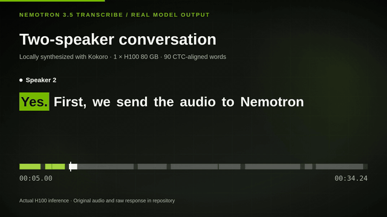
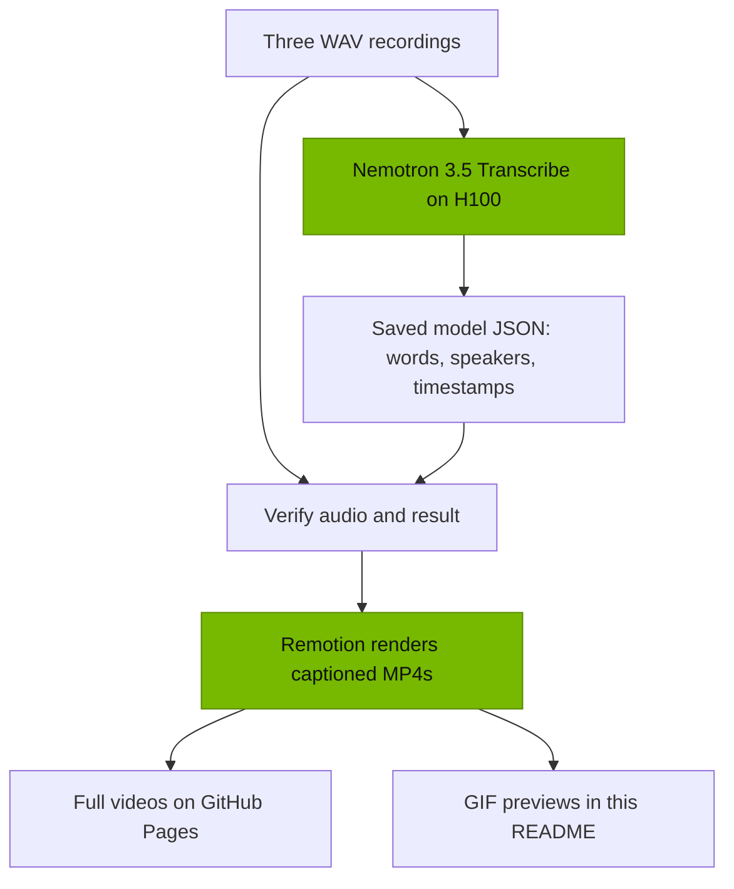

# Nemotron 3.5 Transcribe on one H100

Three short demos using real [NVIDIA Nemotron 3.5 Transcribe](https://huggingface.co/nvidia/NVIDIA-Nemotron-3.5-Transcribe-30B-A4B) inference on one H100 80 GB. The model has **34B parameters total, with 4.3B active**. Watch word-synced captions on a conversation, a speech, and mission radio; then run the same model and audio yourself.

[**User Guide: run the model on vLLM**](#user-guide)

## Demo videos

### Two-speaker conversation · 34 seconds

[](https://darren236.github.io/nemotron-transcribe-h100-demos/conversation.html)

An original two-voice dialogue shows speaker-tagged turns and word-by-word captions. [Play the full video](https://darren236.github.io/nemotron-transcribe-h100-demos/conversation.html) · [Run this example](#two-speaker-conversation)

### JFK speech · 11 seconds

[](https://darren236.github.io/nemotron-transcribe-h100-demos/jfk.html)

A human-speech clip shows word timestamps and subtitles on the [JFK recording used by Whisper](https://github.com/openai/whisper/blob/main/tests/jfk.flac). [Play the full video](https://darren236.github.io/nemotron-transcribe-h100-demos/jfk.html) · [Run this example](#jfk-speech)

### Artemis mission radio · 22 seconds

[](https://darren236.github.io/nemotron-transcribe-h100-demos/artemis.html)

The model transcribes a clip from the [NASA Artemis Audio Library](https://www.nasa.gov/artemisaudio/). The captions show its unedited output, including words that should be checked by listening. [Play the full video](https://darren236.github.io/nemotron-transcribe-h100-demos/artemis.html) · [Run this example](#artemis-mission-radio)

## User Guide

This guide follows [NVIDIA's Nemotron 3.5 Transcribe model card](https://huggingface.co/nvidia/NVIDIA-Nemotron-3.5-Transcribe-30B-A4B) and the versions used for the videos. It runs the downloaded BF16 model through NeMo Speech and vLLM.

**Prerequisites for this BF16 setup:**

| Resource | What you need |
| --- | --- |
| GPU | One NVIDIA H100 with **80 GB VRAM**. This is the configuration used for the videos and [NVIDIA's single-GPU recipe](https://huggingface.co/nvidia/NVIDIA-Nemotron-3.5-Transcribe-30B-A4B). |
| Disk | Plan for a **256 GiB volume**, the size used in the recorded run. The checkpoint alone is **62.86 GiB**; the Python environment, download cache, and outputs need additional space. |
| System | Ubuntu Linux, a working NVIDIA driver (`nvidia-smi` succeeds), `sudo` access, and internet access to GitHub, Hugging Face, and the `uv` installer. The commands below install the remaining packages. |

Run the commands on the H100. After cloning this repository, start in its root unless a step says to change directories.

### 1. Install the runtime and download the model

The pinned NeMo Speech commit and model revision below reproduce the versions used for these demos.

**Install system packages.** `ffmpeg` converts your own recordings to the format expected by the client. The Python headers are needed by the environment build.

```bash
# Refresh the package list, then install tools needed for setup and audio conversion.
sudo apt-get update
sudo apt-get install -y git curl python3.12-dev ffmpeg
```

**Get this demo repository.** If it is already on the H100, enter its root directory and continue.

```bash
git clone https://github.com/darren236/nemotron-transcribe-h100-demos.git ~/nemotron-transcribe-demo
cd ~/nemotron-transcribe-demo
```

You can now run `bash scripts/setup_h100.sh` to do the rest of step 1 at once. The smaller steps below show what that script does.

**Install `uv`.** It creates the Python environment used by NeMo Speech and vLLM.

```bash
curl -LsSf https://astral.sh/uv/install.sh | sh
export PATH="$HOME/.local/bin:$PATH"
```

**Get NeMo Speech.** This pinned commit supplies the model integration and timestamp middleware used in the demos. The `cd` also sets the working directory for the next two blocks.

```bash
# Keep this pinned commit so the environment matches the saved demos.
git clone https://github.com/NVIDIA-NeMo/Speech.git ~/nemo-speech
cd ~/nemo-speech
git checkout --detach 88846dcfa90233dce178cc3d5d9dd6065cdc8380
```

**Install the inference environment.** The first command resolves the locked ASR and vLLM dependencies. The next two install NeMo Speech and the compatible media packages.

```bash
# Install locked dependencies, NeMo Speech, and the compatible media packages.
UV_PROJECT_ENVIRONMENT="$PWD/.venv" uv sync --python 3.12 --extra asr --extra vllm --locked --no-install-project
uv pip install --python .venv/bin/python --no-deps -e .
uv pip install --python .venv/bin/python --no-deps av==19.0.2 opencv-python-headless==5.0.0.93
```

**Check the installed vLLM version.** The recorded setup selected Python 3.12.3 and vLLM 0.32.0.

```bash
source .venv/bin/activate
python -c 'import sys, vllm; print(sys.version, vllm.__version__)'
```

**Download the model checkpoint.** This saves the pinned BF16 weights under `~/nemo-speech/` on the H100; the weights are not stored in this repository.

```bash
# Use the revision that produced the saved model responses.
hf download nvidia/NVIDIA-Nemotron-3.5-Transcribe-30B-A4B \
  --revision 9d8cd6b79bfdd427b6558a5fdbf76fcaf8c75341 \
  --local-dir ./NVIDIA-Nemotron-3.5-Transcribe-30B-A4B
```

Wait for the download to finish even if a full-sized `.incomplete` file appears.

### 2. Serve the model with vLLM

Open **terminal A** on the H100 in this repository's root. Choose **one** launch method: the script below is the simplest way to reproduce these demos. The optional manual command after it starts the same vLLM server and replaces the script; do not run both.

Activate the environment and run the launcher. It calls `vllm serve` with the [one-H100 settings from NVIDIA](https://huggingface.co/nvidia/NVIDIA-Nemotron-3.5-Transcribe-30B-A4B). Its [full command and flags are in the script](scripts/serve_h100.sh).

```bash
# This script runs vllm serve with the required model and timestamp settings.
source ~/nemo-speech/.venv/bin/activate
bash scripts/serve_h100.sh "$HOME/nemo-speech/NVIDIA-Nemotron-3.5-Transcribe-30B-A4B"
```

The launch settings do the following:

| Setting | Purpose |
| --- | --- |
| `VLLM_PLUGINS=nemo_speechlm` | Loads NeMo Speech's vLLM integration for this model. |
| `--dtype bfloat16` | Serves the BF16 checkpoint on the H100. |
| `--served-model-name ...` | Gives clients the model ID used by `transcribe.py`. |
| V1 runner and CTC middleware | Adds word timestamps to the transcription response. |
| `--host 127.0.0.1 --port 8000` | Keeps the inference API on the H100's loopback interface. |

<details>
<summary>Optional: start vLLM manually instead of using the script</summary>

Use this alternative if you want to run `vllm serve` yourself and see every flag. It replaces the launcher command above. After activating the environment in terminal A, set the NeMo Speech plugin, audio limits, and V1 runner:

```bash
export VLLM_PLUGINS=nemo_speechlm
export VLLM_MAX_AUDIO_DECODE_DURATION_S=3600
export VLLM_MAX_AUDIO_CLIP_FILESIZE_MB=180
export VLLM_USE_V2_MODEL_RUNNER=0
```

Then serve the downloaded checkpoint. This is the single `vllm serve` command inside [`scripts/serve_h100.sh`](scripts/serve_h100.sh):

```bash
vllm serve "$HOME/nemo-speech/NVIDIA-Nemotron-3.5-Transcribe-30B-A4B" \
  --host 127.0.0.1 --port 8000 \
  --served-model-name nvidia/NVIDIA-Nemotron-3.5-Transcribe-30B-A4B \
  --trust-remote-code --dtype bfloat16 --gpu-memory-utilization 0.94 \
  --max-model-len 65536 --max-num-batched-tokens 4096 --max-num-seqs 192 \
  --enable-chunked-prefill --no-enable-prefix-caching \
  --use-replayssm --mamba-backend flashinfer --mamba-cache-mode none \
  --mm-processor-cache-gb 0 --no-async-scheduling \
  --limit-mm-per-prompt '{"audio":{"count":6,"length":120000000}}' \
  --speculative-config '{"method":"mtp","num_speculative_tokens":8}' \
  --reasoning-parser nemotron_v3 \
  --trust-request-mm-kwargs \
  --middleware nemo.collections.speechlm2.vllm.salm.ctc_serving.ctc_timestamp_middleware
```

</details>

Keep terminal A open while you transcribe. Open **terminal B** on the H100 in this repository's root. Check readiness after checkpoint loading and warmup:

```bash
curl -fsS http://127.0.0.1:8000/v1/models
```

The response should list the served model. The client script calls vLLM's OpenAI-compatible `/v1/chat/completions` endpoint on that same machine.

### 3. Transcribe the demo audio

In terminal B, run these examples from this repository's root. The input WAVs are included in `assets/`. For each example, `transcribe.py` sends the audio to vLLM and saves its response as JSON; `export_srt.py` checks that JSON against the same WAV and makes captions. Outputs go to `runs/reproduced/`, so the showcased results remain untouched.

#### Two-speaker conversation

Run the original two-voice recording to see speaker tags and timed turns. The first command makes the transcript; the second makes an SRT caption file.

```bash
python3 scripts/transcribe.py assets/demo_conversation.wav --output runs/reproduced/conversation.json
python3 scripts/export_srt.py runs/reproduced/conversation.json assets/demo_conversation.wav --output runs/reproduced/conversation.srt
```

[Input audio](assets/demo_conversation.wav) · [Saved model response](runs/demo_conversation.json) · [Saved captions](runs/demo_conversation.srt)

#### JFK speech

Run the short human-speech clip to create a transcript and word-timed subtitles:

```bash
python3 scripts/transcribe.py assets/jfk_speech.wav --output runs/reproduced/jfk.json
python3 scripts/export_srt.py runs/reproduced/jfk.json assets/jfk_speech.wav --output runs/reproduced/jfk.srt
```

[Input audio](assets/jfk_speech.wav) · [Saved model response](runs/jfk_speech.json) · [Saved captions](runs/jfk_speech.srt)

#### Artemis mission radio

Run the NASA radio clip to create a transcript and subtitles. Listen back before using its transcript as final captions:

```bash
python3 scripts/transcribe.py assets/artemis_houston.wav --output runs/reproduced/artemis.json
python3 scripts/export_srt.py runs/reproduced/artemis.json assets/artemis_houston.wav --output runs/reproduced/artemis.srt
```

[Input audio](assets/artemis_houston.wav) · [Saved model response](runs/artemis_houston.json) · [Saved captions](runs/artemis_houston.srt)

Each JSON includes `text`, word `start`/`end` times and speaker tags in `words`, the original `raw_response`, and the SHA-256 of the exact input WAV. Check that `alignment.error` is `null` before using the word times. The saved results are examples of model use, not accuracy or speed benchmarks.

The script allows up to 32,768 output tokens for a recording up to one hour. [NVIDIA notes](https://huggingface.co/nvidia/NVIDIA-Nemotron-3.5-Transcribe-30B-A4B) that a dense one-hour transcript may need about 20,000. If the server ends the response at the token limit, the script raises an error without saving a partial transcript; split the recording into shorter clips and run each separately.

### 4. Use your own audio

Use a filename without spaces for these commands. First, convert your audio to the mono, 16 kHz, 16-bit PCM WAV required by the client:

```bash
ffmpeg -i my_recording.mp3 -ac 1 -ar 16000 -c:a pcm_s16le my_recording.wav
```

Send that WAV to the local vLLM server and save the model response:

```bash
python3 scripts/transcribe.py my_recording.wav --output runs/reproduced/my_recording.json
```

Create SRT captions from the saved response and its matching WAV:

```bash
python3 scripts/export_srt.py runs/reproduced/my_recording.json my_recording.wav --output runs/reproduced/my_recording.srt
```

### Optional: synthesize a new conversation

The included `assets/demo_conversation.wav` is the exact WAV behind the saved model response. To create a similar two-voice recording from the original script, install [Kokoro ONNX](https://github.com/thewh1teagle/kokoro-onnx) and download its public model and voices files. A new synthesis may differ from the included WAV, so send the new WAV through `transcribe.py` before exporting captions.

From this repository's root, create a separate Python environment for the speech synthesizer. The `uv` installation from step 1 is already available in terminal B if its `PATH` is set; otherwise add it here:

```bash
export PATH="$HOME/.local/bin:$PATH"
uv venv --python 3.12 .venv-demo
uv pip install --python .venv-demo/bin/python kokoro-onnx numpy soundfile
```

Download Kokoro's public model and voices into the local `models/` folder:

```bash
mkdir -p models runs/reproduced
curl -fL https://github.com/thewh1teagle/kokoro-onnx/releases/download/model-files-v1.1/kokoro-v1.0.int8.onnx -o models/kokoro-v1.0.int8.onnx
curl -fL https://github.com/thewh1teagle/kokoro-onnx/releases/download/model-files-v1.1/voices-v1.0.bin -o models/voices-v1.0.bin
```

Generate a new WAV; then use the commands in step 4 to transcribe that WAV and make captions:

```bash
# Synthesize audio locally; this does not call the transcription server.
.venv-demo/bin/python scripts/make_demo_audio.py --model models/kokoro-v1.0.int8.onnx --voices models/voices-v1.0.bin --output runs/reproduced/new_conversation.wav
```

Now send the new WAV to vLLM and export captions for that exact recording:

```bash
python3 scripts/transcribe.py runs/reproduced/new_conversation.wav --output runs/reproduced/new_conversation.json
python3 scripts/export_srt.py runs/reproduced/new_conversation.json runs/reproduced/new_conversation.wav --output runs/reproduced/new_conversation.srt
```

### Troubleshooting and shutdown

| Symptom | What to do |
| --- | --- |
| `ensurepip is not available` | Use `uv` as above; the recorded Ubuntu image lacked the matching `python3-venv` package. |
| `Python.h: No such file or directory` | Install `python3.12-dev`, then restart vLLM. |
| `/v1/models` refuses connections | Check the server terminal; loading and warmup can take several minutes. |
| No `ctc_timestamps` or an alignment error | Check that `serve_h100.sh` enabled the V1 runner and CTC middleware; do not publish failed word timings as captions. |

When finished, stop the server and stop the GPU instance in your cloud provider. For a Brev instance, run `brev stop <instance-name>` and verify its status with `brev ls --all`. The [detailed H100 runbook](docs/H100_RUNBOOK.md) records the full setup and observed fixes.

## How the videos were made

We transcribed each WAV on the H100 and saved the model's words, speaker tags, and CTC timestamps. `scripts/build_gallery.py` checks that each response matches its exact WAV before Remotion renders word-synced captions over the original audio. The GIFs are short, silent excerpts of the finished MP4s.



See [video/README.md](video/README.md) for the commands to rebuild the videos and GIFs from the saved results.
