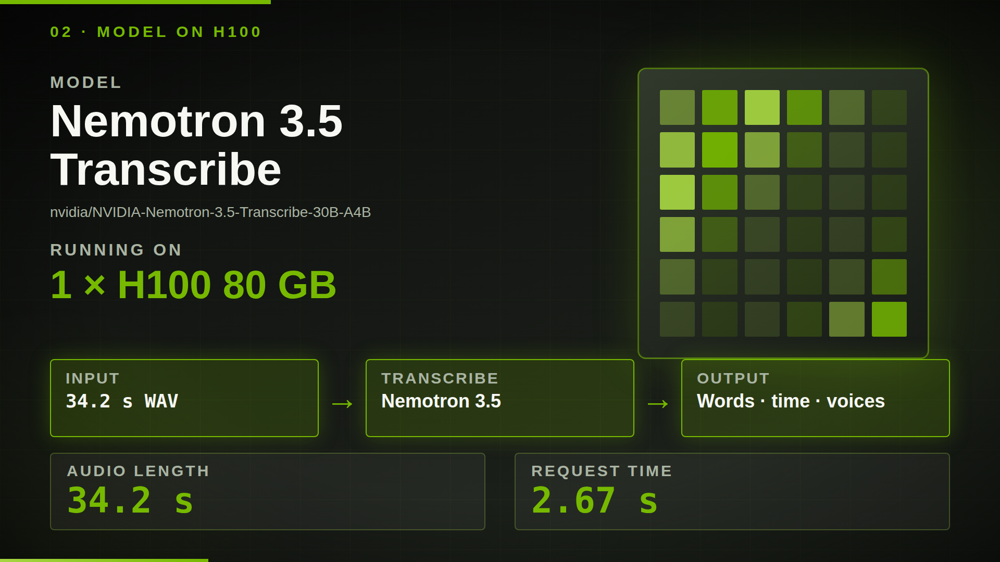
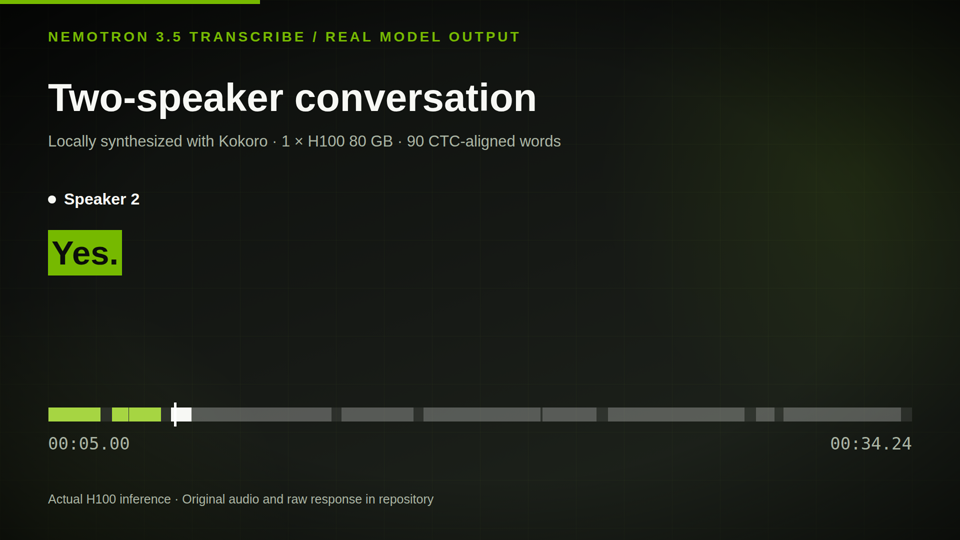
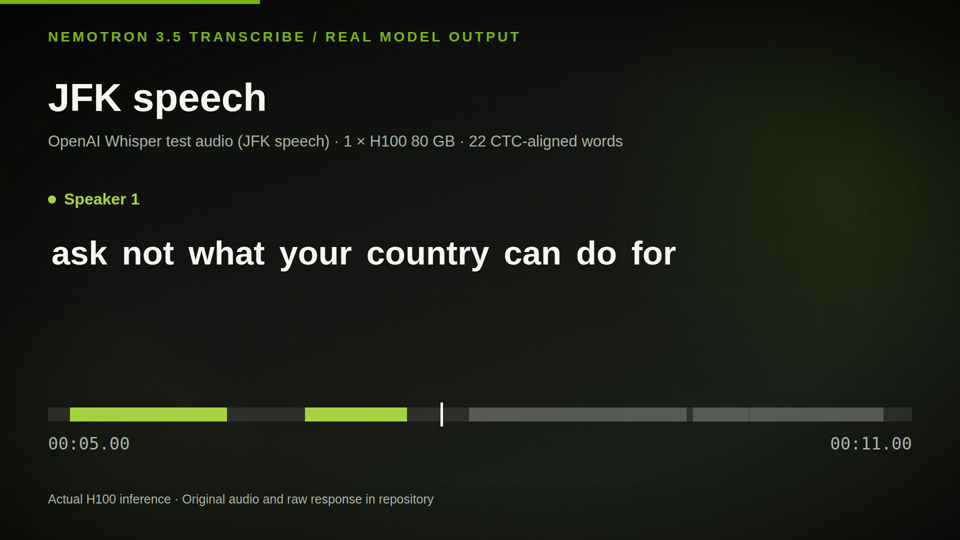
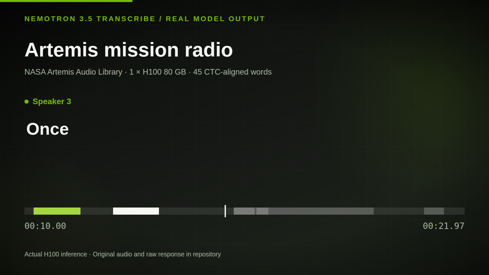

# Nemotron 3.5 Transcribe on one H100

Three short demos made from **real NVIDIA Nemotron 3.5 Transcribe inference** on one H100 80 GB: a two-speaker conversation, a historical speech, and mission radio. Each clip plays the exact model-input audio while highlighting the model's word timestamps. The saved raw responses, captions, input hashes, and reproduction commands are included.

[**Watch the 60-second overview**](video/out/nemotron-transcribe-demo.mp4) · [**Set up inference and run the demos**](docs/USER_GUIDE.md) · [**Explore saved results locally**](#explore-the-saved-results)



## Watch the demos

### Two-speaker conversation · 34 seconds

[](video/out/conversation-caption.mp4)

An original Kokoro-synthesized dialogue shows speaker-tagged turns and word-synced captions. [Watch MP4](video/out/conversation-caption.mp4) · [Audio](assets/demo_conversation.wav) · [Model result](runs/demo_conversation.json) · [SRT](runs/demo_conversation.srt) · [Run it yourself](docs/USER_GUIDE.md#1-two-speaker-conversation)

### JFK speech · 11 seconds

[](video/out/jfk-caption.mp4)

A short human-speech recording from the [Whisper test fixtures](https://github.com/openai/whisper/blob/main/tests/jfk.flac) shows word timestamps on a familiar excerpt. [Watch MP4](video/out/jfk-caption.mp4) · [Audio](assets/jfk_speech.wav) · [Model result](runs/jfk_speech.json) · [SRT](runs/jfk_speech.srt) · [Run it yourself](docs/USER_GUIDE.md#2-jfk-speech)

### Artemis mission radio · 22 seconds

[](video/out/artemis-caption.mp4)

Audio from the [NASA Artemis Audio Library](https://www.nasa.gov/artemisaudio/) shows the model on radio communications. The displayed words are unedited model output; check them against the recording before reuse. [Watch MP4](video/out/artemis-caption.mp4) · [Audio](assets/artemis_houston.wav) · [Model result](runs/artemis_houston.json) · [SRT](runs/artemis_houston.srt) · [Run it yourself](docs/USER_GUIDE.md#3-artemis-mission-radio)

## Run inference

Start with the [user guide](docs/USER_GUIDE.md). It covers the H100 environment, model download, vLLM server, all three use cases, SRT export, a recording of your own, troubleshooting, and shutdown. The [H100 runbook](docs/H100_RUNBOOK.md) and [run log](docs/RUN_LOG_2026-10-29.md) preserve the exact Brev commands and observations from the recorded run.

The [provenance manifest](runs/gallery_manifest.json) records model and NeMo Speech revisions, source and input hashes, response hashes, word counts, and alignment status. These examples demonstrate usage; they are not accuracy or latency benchmarks.

## Explore the saved results

No GPU is needed to replay the saved outputs. From the repository root:

```bash
python3 -m http.server 8765 --bind 127.0.0.1
```

Open `http://127.0.0.1:8765/`. The [static viewer](index.html) checks each WAV hash before enabling word-following playback, phrase search, and SRT download. Selecting a demo replays a saved H100 result; it does not send a new model request. You can also load your own result JSON and matching WAV.

## Source and design

The short clips and overview are built with [Remotion](video/README.md) from the saved result data. Claude Code authored the initial scene scaffold; the final video sources, render inputs, and MP4s are included. The visuals use NVIDIA-inspired green `#76B900`, charcoal, and white with original graphics and no NVIDIA logo asset.

- [NVIDIA model card and inference recipe](https://huggingface.co/nvidia/NVIDIA-Nemotron-3.5-Transcribe-30B-A4B)
- [Demo audio sources and provenance](demos/README.md)
